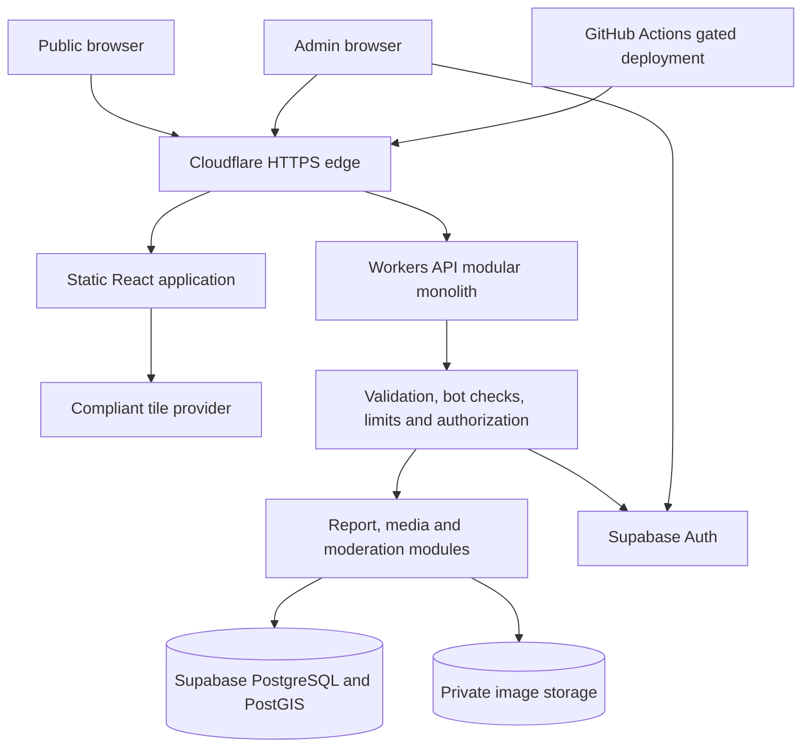

# PotholeMap — Project Master Plan

**Version:** 1.4 · **Updated:** 2026-11-04 · **Status:** Planning baseline; implementation not verified.

**Goal:** Publicly launch a secure, mobile-first, crowdsourced pothole reporting map with **Rp0 initial infrastructure budget**.

## 1. Document ownership and execution rules

This document defines product scope, architecture, backend boundaries, global requirements and the milestone roadmap. **It is not an instruction to implement the whole application.**

| Document | Owns | Does not authorize |
|---|---|---|
| `docs/PROJECT_MASTER_PLAN.md` | Product, architecture, roadmap and release gates | Building all roadmap features |
| [M0 contract](milestones/M0_ENGINEERING_FOUNDATION.md) | M0 issues, dependencies, acceptance criteria and exit evidence | Starting M1 or implementing product features |
| [Milestone index and M0–M13 contracts](milestones/README.md) | Shared execution rules and one contract per milestone | Activating another milestone or building all files at once |
| [Root `AGENTS.md`](../AGENTS.md) | Permanent agent conventions, maintained through M0-02 | Overriding the user's authorized task |
| Future `docs/adr/` | Technical rationale, alternatives and measured evidence | Silent scope, architecture or cost changes |
| GitHub issue / PR | One bounded implementation/review unit | Unrelated issues |

### No one-shot implementation

1. Read applicable `AGENTS.md`, this master plan and the selected milestone contract before implementation.
2. Work only on the user-authorized milestone and issue. Editing plans authorizes documentation work only.
3. If asked to start a milestone without an issue number, select its first ready, incomplete issue and state the choice. That does not authorize implementing the entire milestone in one change.
4. Deliver one focused issue/branch/PR with checks and evidence. Stop at that handoff unless the user explicitly authorized continued issue-by-issue work.
5. A roadmap row, drafted contract or completed predecessor never automatically activates another milestone. Advancement requires satisfied dependencies, exit evidence and the user's instruction.
6. Missing evidence means not verified, not complete. Record exit signoff by the maintainer; never infer it from a green local build.
7. Record unexpected dependencies and revise the appropriate plan before adding implementation scope. Do not import later features to finish a current demo.
8. Existing user authorization governs external actions. A planning task does not authorize merging, deployment, production-data/secret changes or paid services.

**Current state:** M0 is not verified complete; selected-issue status and evidence live in the M0 ledger. The root agent contract has been prepared under the user's limited M0-02 documentation request. At the user's request, all M1–M13 contracts are now drafted for forward planning; they remain blocked for implementation until prerequisite review and user activation. Planning checklists are not evidence of existing infrastructure.

## 2. Product and MVP boundaries

PotholeMap helps people photograph road damage, pin its location and view community reports. It is not an official government repair-request channel and does not guarantee repairs. Indonesian is the initial UI language; pilot geography is undecided.

### Journeys and scope

- **Explore:** Without login, open map → pan/zoom → approved markers → approved photo, location, date, description and road status. Include bounded viewport queries, status filters, clustering when needed and an accessible report list.
- **Report:** Choose one photo → optional GPS or manual road pin → optional description → CAPTCHA → submit → report ID and pending confirmation. Location remains manually adjustable; time comes from the server.
- **Moderate:** Admin signs in with MFA → reviews private pending reports → approves/rejects → separately updates road condition. Changes have an audit trail.
- **Operate:** Privacy/terms, attribution, contact/takedown channel, anti-abuse controls, CI/CD, quota monitoring, emergency submission pause, DB and photo recovery.

**Deferred beyond v1:** AI detection, public accounts, voting, reputation, automatic deduplication, advanced analytics, native apps, notifications, government integrations, automated repair verification, payments, microservices, Kubernetes, Redis and self-hosted production servers. No message broker in the baseline; reconsideration criteria are in section 7.

**Success:** A real mobile user submits a valid report, an admin approves it, another visitor sees it on the map, and deployment/security/recovery checks pass.

## 3. Technology and budget baseline

Planning choices require compatibility evidence; M0-03 validates hosting before bootstrap.

| Concern | Baseline | Constraint |
|---|---|---|
| Source control | Public GitHub repository; GitHub Flow | Protected main, focused PRs, squash merges |
| Frontend | React + Vite + TypeScript strict | Static SPA; no SSR requirement |
| API and hosting | Cloudflare Workers Free, static assets and API | Prefer one origin; prove runtime compatibility |
| Database | Supabase Free PostgreSQL + PostGIS | SQL migrations, spatial index, restrictive grants and RLS |
| Photos | Supabase private Storage | Generated keys, bounded intake, safe publication |
| Admin identity | Supabase Auth | Server-verified identity, role and MFA |
| Map | Leaflet + compliant tile provider | Provider/production-use policy unresolved; attribution required |
| Abuse prevention | Turnstile + shared enforceable rate limits | Server verification; no authoritative per-instance memory limiter |
| Toolchain | pnpm, pinned Node/pnpm, Vitest, ESLint, Prettier | Frozen lockfile; versions selected during M0 |
| Delivery | GitHub Actions + Wrangler | CI for exact production SHA; isolated preview |
| Domain/recovery | Free Cloudflare subdomain; private DB and photo exports | No automatic billing; restore drills |

**Budget rule:** Free plans only. No card-required, auto-billed or paid dependency without explicit approval. Verify quotas, acceptable-use terms, inactivity and account features at setup and launch. Do not promise guaranteed uptime.

**Runtime gate:** M0-03 records routing, runtime, secrets, deployment, rollback feasibility and image-processing assessment in ADR-001. If the stack fails, propose a genuinely different free-compatible alternative; do not describe the same stack as a fallback.

**Image gate:** Client compression is not sanitization. M0 assesses feasibility; M6 proves safe server-side processing. If approved infrastructure cannot support it, keep anonymous photo intake/publication disabled and resolve the design before M7 integration or beta. A broker does not itself provide a capable image-processing runtime.

## 4. System boundaries



Public reads/mutations go through the API. Admin clients may use Supabase Auth for sign-in; browsers never receive privileged database/storage secrets. Browser, API, database permissions and storage are distinct trust boundaries. Public endpoints explicitly filter approved records; guessed pending/rejected IDs return 404. Photo access requires publication eligibility or verified admin permission.

Diagrams: [HLD source](diagrams/PotholeMap_HLD.drawio), [HLD preview](diagrams/PotholeMap_HLD.jpg), [LLD source](diagrams/PotholeMap_LLD.drawio), [LLD preview](diagrams/PotholeMap_LLD.jpg). They are component overviews; sections 5–7 specify behavior. The HLD source also contains an LLD page; keep its duplicate representation aligned when diagrams change.

## 5. Backend design

### 5.1 Modules and ownership

Use a **modular monolith**: modules within one Workers API deployment. Start with small handlers, use-case functions and data adapters. A module is not a microservice.

| Module/layer | Owns | Boundary | Delivery owner |
|---|---|---|---|
| `http` | Routes, body limits, request IDs, errors | No scattered business rules in handlers | M0 health only; M4/M7/M10 routes |
| `security` | Sessions, roles, Turnstile, limits, CSRF/origin policy | Never trust browser role/actor IDs or arbitrary forwarded IP headers | M7/M8/M9 |
| `reports` | Public queries and anonymous creation | Explicit response fields; no raw row serialization | M4/M7 |
| `geo` | Bbox/area limits, spatial predicates and pagination | No whole-dataset download | M2 schema; M4 queries |
| `media` | Actual format/dimension checks, sanitize, private objects/read access | Client MIME/compression is not a security boundary | M6; M10 publication |
| `moderation` | State transitions, concurrency and transactional audit | No separate update/audit HTTP calls | M10 |
| `data` | Supabase adapters, projections, SQL/RPC boundary | No privileged SDK calls in UI | M2/M4 onward |
| `operations` | Kill switch, safe logs, cleanup, quotas and recovery | No sensitive payloads/tokens/private links in logs | M6 cleanup; M8 controls; M12 operations |

Suggested layout, populated only as the owning issue delivers code:

```text
src/server/
  index.ts
  http/
  security/
  modules/
    reports/
    geo/
    media/
    moderation/
  data/
  operations/
supabase/migrations/
tests/                         # unit/integration, E2E when journeys exist
```

M0 creates only the runtime skeleton and `/health`, not empty product modules/endpoints. Additional HTTP framework, ORM, DI container or backend service is not mandated by this plan.

### 5.2 Data access and authorization

- Proposed transport: Workers → Supabase HTTPS Data API/RPC, Storage and Auth APIs. Validate in M2; no connection pool or separate backend server by default.
- SQL migrations own constraints, indexes and narrow functions. Atomic multi-row mutations use **one database transaction**, for example a restricted SQL function via RPC. Multiple SDK calls are not a transaction.
- Restrictive grants and RLS are required. Privileged service credentials can bypass RLS; API authorization and explicit approved-only predicates remain mandatory. Test direct Data API/RPC access as well as app routes.
- No public table writes or role self-promotion. Revoke unnecessary function execution grants; elevated functions require a reviewed security model and fixed search path where applicable.
- Admin actor identity comes from a server-verified session. Verify current admin membership, and enforce authorization inside the transaction boundary too. M9/M10 choose/test the JWT/RPC propagation model; a client-supplied actor argument is never authority.
- Public DTOs expose only intended fields, never reviewer identity, audit data, internal object paths or privileged metadata.

### 5.3 Persistent state and invariants

| Entity | Essential data | Invariant |
|---|---|---|
| `reports` | UUID, bounded plain description, `geography(Point,4326)`, private photo path, moderation/road states, created/updated/reviewed timestamps, reviewer, version | New report is pending/reported; publication requires approval and safe processed media |
| `admin_profiles` | Auth user ID, admin role, created time | No public role writes |
| `report_status_events` | Report ID, verified actor, event type, old/new values, time | Required append-only audit; mutation and event commit together |

- Moderation: `pending | approved | rejected`. Road: `reported | verified | fixed`; public meaning only after approval. M10 defines exact transitions, takedown and reopening policy; do not invent extra states during M2.
- Version/conditional updates prevent stale admin changes; return 409 without a partial write/audit.
- GiST location index and indexes for moderation queue/stable `(created_at, id)` paging. DB/API enforce coordinate validity, enums and required fields.
- Photo path is an object reference by convention, not a relational FK. M6 defines storage/row reconciliation.
- Bounded operational submission-idempotency records and the chosen limiter's state are specified in M7, with hardening/measurement in M8; no generic jobs/event-bus schema preemptively.
- Server-generated timestamps; user-selected road point is location. EXIF GPS is untrusted and metadata is removed.

### 5.4 API contracts and milestone owners

| Method / route | Access and behavior | Owner |
|---|---|---|
| `GET /health` | Public; minimal health/deployed version, no secrets | M0 |
| `GET /api/reports?bbox=...&status=...&limit=...&cursor=...` | Public; approved summaries, road-status filter, capped area/limit, stable cursor | M4 |
| `GET /api/reports/:id` | Approved detail only; authorized short-lived photo reference when available; otherwise 404 | M4; media M10 |
| `POST /api/reports` | Anonymous multipart photo/point/description/Turnstile; 201 only after safe image and pending row persist | M7 |
| `GET /api/admin/reports?moderation=pending` | Verified admin; paginated queue and authorized private preview | M10 |
| `PATCH /api/admin/reports/:id/moderation` | Admin; decision + expected version; transactional audit | M10 |
| `PATCH /api/admin/reports/:id/status` | Admin; road status + expected version; transactional audit | M10 |

Successful payloads use `data`; errors use `error.code`, `error.message`, `request_id`. Owning milestones define exact schemas/limits. Expected errors: 400 invalid input, 401 invalid/missing session, 403 forbidden, 404 unavailable report, 409 conflict, 413 oversized, 429 throttled, 500 unexpected, 503 dependency unavailable/submissions disabled. Hide upstream internals.

M4 uses approved synthetic fixtures and a placeholder/no image until publication exists; never expose a storage path as a shortcut. No separate upload endpoint by default; splitting it requires a revised claims/cleanup contract.

## 6. Backend execution and failure handling

### Public reads

Viewport change → debounce → validate bbox/area/status/limit/cursor → indexed approved-only query → minimal summaries. Marker click fetches detail. Prefer no report/image cache initially; any later cache needs an expiry/takedown policy. Signed photo links remain usable until expiry, so define a short bounded lifetime and document the revocation limitation.

### Anonymous submission — synchronous baseline

1. Check submission switch, enforce actual body/stream limits and shared abuse controls, then verify Turnstile before expensive work. Do not trust Content-Length alone.
2. Validate fields, coordinates, one file, actual format, decoded dimensions and pixel cap. Proposed input cap: 5 MB, JPEG/PNG/WebP only. M6 confirms formats/output/pixel limits against measured runtime safety.
3. Decode/re-encode server-side, strip EXIF, generate an unpredictable key and store sanitized output privately. Never publish raw files as a fallback.
4. Persist pending report and private object reference. Return 201 plus an explicitly nonpublic pending receipt.
5. On confirmed DB rejection, compensate by deleting the staged object. On timeout/unknown commit, reconcile with a stable operation/report ID before retry/deletion; do not delete an object a committed row may reference.
6. M7 specifies bounded idempotency for mobile retries: concurrent same-key operations create at most one report; changed payload conflicts. A committed replay still passes abuse controls but does not require reusing a consumed Turnstile token; new work requires a valid token. This is separate from semantic duplicate-report detection, which is deferred.
7. Prove cleanup for process interruption, failed delete and unknown outcomes. Storage and DB do not share an ACID transaction.

**Exposure gate:** M6/M7 work stays local or in isolated test environments. Public anonymous submissions remain disabled until M8 controls, M9/M10 moderation/publication and launch gates pass. Earlier milestones still include the controls needed for safe testing; M8 hardens and verifies them.

### Moderation

Verified admin identity + role + applicable CSRF/origin checks → authorized private preview → conditional DB transaction updates report and audit → eligible approved detail becomes publicly queryable. Unauthorized/stale/failed mutations must not partly commit. Road changes are separate audited mutations. Human review does not replace sanitization.

### Rate limits and outages

M7 chooses a conservative shared free-compatible write limiter before isolated submission integration; M8 validates/refines the same design, extends read coverage and measures cross-instance behavior. Small atomic PostgreSQL counters are a candidate; measure DB cost/contention, set expiry and combine with edge controls where available. No Redis/broker by default. Trust platform client-address context only; minimize/expire pseudonymous identifiers. If required abuse checks, DB or storage fail, submissions fail closed with retry messaging. No in-memory write queue.

## 7. Background work and message-broker decision

**MVP baseline: no message broker.** Current operations are bounded request/response work. Pending reports are a human moderation queue in PostgreSQL; audit records are history, not queued jobs. Concurrent visitors alone do not justify a broker.

| Work | MVP mechanism | Reliability requirement |
|---|---|---|
| Photo processing and submission | Await validated runtime processing/persistence | Never acknowledge durable success before persistence |
| Moderation and audit | One synchronous DB transaction | All-or-nothing |
| Orphan cleanup | Bounded maintainer-run reconciliation; schedule only if feasible | Grace period, reference recheck, safe rerun, checkpoint and failure report |
| Retention/takedown deletion | Reviewed bounded runbook operation | Hide report first; audited action and safe retry |
| DB/photo recovery | Explicit private export and restore procedure | Consistency checks and restore drill |
| Quota/log review | Safe logs and provider dashboards | Minimal sensitive data and bounded retention |

Cleanup excludes recent/active uploads, rechecks references and handles races with in-flight submission before deleting. M6 proves a manual procedure; M12 operationalizes it. Do not assume free cron can process an unbounded bucket. Unawaited promises or `waitUntil` do not provide durable retries.

**Revisit only for a concrete need:** durable async retries, measured processing outside the request budget, bursts demonstrably exceeding consumer capacity, or future notifications/integrations requiring independent delivery. A new ADR compares bounded manual/scheduled work, a small DB-backed job design and managed queues against the actual workload and budget. Do not implement those alternatives in advance.

For async photos, first prove the consumer runtime can sanitize safely; a broker alone does not resolve CPU limits. Then revise API to 202/processing semantics, separate media processing from moderation state, quarantine originals privately with retention, and block approval until processing succeeds. Define stable IDs, idempotent consumers, bounded retries, dead-letter handling, expiry, backlog monitoring and recovery. A DB mutation plus message send requires outbox/equivalent durable recovery for partial failure. This is a future design change, not current implementation scope.

Cloudflare Queues currently has a free allowance; cost alone is not the reason to omit it. Its documented at-least-once delivery still requires duplicate-safe consumers. Availability does not create a product requirement. Official references are in section 13.

## 8. UI, security and privacy requirements

- Desktop map/sidebar; mobile map/bottom sheet; loading, empty, offline/error and pending states.
- Camera/file picker, photo preview, GPS denial/manual-pin fallback, optional description and consent/notice. Warn against identifiable people/plates.
- Admin login/MFA, queue, private detail, decisions, road updates and audit visibility.
- Privacy, terms/community rules, tile attribution, contact/takedown, not-found/error pages.
- Keyboard navigation, labels, contrast, modal focus and accessible report-list alternative.
- Server validation with Zod; plain-text descriptions, parameterized queries, bounded geo/text/file inputs. No SVG/HTML or arbitrary remote image fetching.
- Test corrupt/spoofed/oversized files, pixel bombs, EXIF removal, forged roles/IDs, XSS, bot-token failure and limiter bypass.
- HTTPS, tested CSP, `nosniff`, `frame-ancestors`, restrictive CORS, secure/httpOnly/SameSite cookies if used, CSRF protection for cookie-authenticated changes.
- Server-only secrets; public `VITE_*` values are nonsecret. Ignore local env files, scan repo/client bundle, rotate leaked credentials.
- Minimize reporter data/IP logging; define report/photo/log retention and provider disclosures. No mandatory reporter identity.

## 9. Engineering, environments and operations

One issue → short-lived branch → focused PR → checks + self-review/manual verification → squash merge. Protected, production-ready main; no force push/delete, no long-lived develop branch. Conventional Commits. Public visibility is decided; code license and submitted-image rights remain open.

PR completion requires acceptance criteria, relevant tests, lint/typecheck/build, no leaked secrets, migration safety if applicable, updated docs/env examples and preview verification for UI changes. No invented evidence or unrelated packages.

### CI/CD and environments

- Pin Node/pnpm. CI: `pnpm install --frozen-lockfile` → `pnpm format:check` → `pnpm lint` → `pnpm typecheck` → `pnpm test` → `pnpm build`.
- Minimal workflow permissions, SHA-pinned third-party actions, no deployment secrets for untrusted PRs. Dependency audit policy blocks severe exploitable release findings; other advisories are triaged.
- Production deploy: main only, successful CI for exact deployed SHA, version recording, `/health` smoke and rollback. Verify actual GitHub account protection features; do not assume a gate exists.
- Preview: fixtures or isolated dev data, never production secrets/data; safe maintainer-triggered deployment if needed.
- Local: ignored `.env.local`, local Supabase preferred. Production: dedicated project and scoped secrets. No paid staging project required.
- SQL migrations are separate reviewed operations, locally tested, backed up and compatible with deployment order. Prefer expand/contract. No automatic production schema changes in M0.

### Recovery

Private DB exports plus independent image exports; never public Git/CI artifacts. Include consistency checks/manifests so restored paths resolve. Restore a sample DB and image into fresh dev before launch. M12 defines destination, retention, frequency and recovery targets.

Use `docs/runbooks/` for setup, deploy, rollback, outage, storage full, spam, leaked key, moderation abuse, cleanup and restore as each owning milestone delivers them. Monitor safe errors, failed uploads, latency and DB/storage/egress quotas; review weekly in beta. Emergency response can pause submissions and roll back the app; restore data only after consistency assessment. Free-tier outages show maintenance/retry messages.

## 10. Milestone roadmap and activation gates

Minimum dependencies are not permission to jump ahead. Default order is M0 → M13. All milestone contracts are drafted at the user's request; before activation, reconcile each with actual predecessor evidence, ADRs, implementation and current provider constraints. Execution requires user instruction after prerequisite signoff. The [execution index](milestones/README.md) defines common issue, verification and exposure gates; each milestone file owns its detailed ledger.

| Milestone | Deliverable / backend ownership | Minimum prerequisite | Exit gate | State |
|---|---|---|---|---|
| [M0 Engineering Foundation](milestones/M0_ENGINEERING_FOUNDATION.md) | Governance, spike, bootstrap, CI/CD, environments | None | Reproducible setup; CI, isolated preview, harmless production and rollback evidence | M0-02 artifact in review; milestone not complete |
| [M1 Application Shell](milestones/M1_APPLICATION_SHELL.md) | Responsive routing, layout, accessibility primitives | M0 signoff | Mobile/desktop shell; no live reporting | Drafted; blocked for implementation |
| [M2 Database Foundation](milestones/M2_DATABASE_FOUNDATION.md) | Schema, PostGIS, migrations, grants/RLS, SQL/RPC and fixtures | M0 signoff; M1 in default order | Reproducible DB; direct-access permission tests | Drafted; blocked for implementation |
| [M3 Map Foundation](milestones/M3_MAP_FOUNDATION.md) | Tiles, map, GPS/manual pin | M1 | Compliant provider; location-denial flow works | Drafted; blocked for implementation |
| [M4 Public Report API](milestones/M4_PUBLIC_REPORT_API.md) | HTTP/data/geo modules; approved-only reads | M2 | Bounded indexed queries; no unapproved/private leakage | Drafted; blocked for implementation |
| [M5 Report Explorer](milestones/M5_REPORT_EXPLORER.md) | API-backed markers, details, filters and list | M3, M4 | Viewport queries and loading/error/empty UX | Drafted; blocked for implementation |
| [M6 Safe Photo Pipeline](milestones/M6_SAFE_PHOTO_PIPELINE.md) | Media, private objects, sanitization, reconciliation | M2, M0 feasibility evidence | Runtime safety and interrupted-upload cleanup proven; no public intake | Drafted; blocked for implementation |
| [M7 Report Submission](milestones/M7_REPORT_SUBMISSION.md) | Form, create use case, Turnstile, retries/idempotency | M5, M6 | Pending creation tested in isolation; public intake disabled | Drafted; blocked for implementation |
| [M8 Abuse Prevention](milestones/M8_ABUSE_PREVENTION.md) | Shared limits, pause switch, headers, abuse tests | M4, M7 | Cross-instance limits/outage behavior proven | Drafted; blocked for implementation |
| [M9 Admin Authentication](milestones/M9_ADMIN_AUTHENTICATION.md) | Identity, MFA, role/session guards | M1, M2 | Forged/expired/non-admin access denied | Drafted; blocked for implementation |
| [M10 Moderation Workflow](milestones/M10_MODERATION_WORKFLOW.md) | Atomic audit/decisions, concurrency, media access | M6, M7, M8, M9 | Submit → pending → approve → public marker; rejected stays private | Drafted; blocked for implementation |
| [M11 Quality & Accessibility](milestones/M11_QUALITY_ACCESSIBILITY.md) | Mobile, accessibility, E2E, performance | M5, M10 | Core journeys and failure/security regressions pass | Drafted; blocked for implementation |
| [M12 Production Readiness](milestones/M12_PRODUCTION_READINESS.md) | Monitoring, retention, recovery, security/rollback drill | M8, M10, M11 | Recovery/operations evidence; release blockers resolved | Drafted; blocked for implementation |
| [M13 Public Beta](milestones/M13_PUBLIC_BETA_LAUNCH.md) | Limited rollout, disclosures, feedback | M12 signoff | Launch checklist and explicit release authorization | Drafted; blocked for implementation |

Issue details/tracking live only in their individual [milestone contracts](milestones/README.md). Do not duplicate issue acceptance criteria here. Drafting the full set changes documentation readiness, not implementation status. Public intake remains off through M12; M13 owns authorized enablement after all launch gates.

## 11. Public launch checklist

- [ ] Real mobile submission, manual-pin fallback and explorer verified.
- [ ] Pending/rejected reports, raw uploads and private metadata inaccessible, including direct Data API/storage access.
- [ ] Sanitization, EXIF strip, body/file/pixel limits, Turnstile, shared limits and pause tested.
- [ ] Admin MFA/authorization, concurrent moderation and transactional audit tested.
- [ ] Exact-SHA CI gate, preview isolation, secret scan and rollback verified.
- [ ] DB **and** image restore passed; quotas and outage messaging ready.
- [ ] Privacy, terms, image rights, retention, attribution and takedown contact live.
- [ ] Free-tier terms/billing state rechecked; no accidental paid service.
- [ ] Pilot scope/moderation capacity agreed; no repair-guarantee implication.
- [ ] M12 evidence reviewed and maintainer explicitly authorizes beta.

## 12. Decision register and risks

**Agreed planning baseline:** PotholeMap; Indonesian-first public map; public GitHub; anonymous reporting; admin-only accounts; prepublication moderation; Rp0 start; React/Vite/TypeScript + Workers proposal; Supabase; pnpm; GitHub Actions; modular monolith; no broker by default; 14 milestones with issue-sized delivery. These are not claims of completed setup.

| Open decision | Resolve by | Required outcome |
|---|---|---|
| Code license / user-image rights | M0-01 / before M13 | Maintainer selection, not assumed MIT |
| Hosting/runtime viability | M0-03 | ADR-001 and measured spike |
| Safe image runtime and exact limits | Feasibility M0-03; proof M6 | No public intake until solved |
| Local/preview setup and actual GitHub gates | M0-08–M0-11 | Account-specific isolation/protection evidence |
| HTTPS Data API/RPC and grants | M2; admin context M9/M10 | Integration/direct-access tests |
| Tile provider/expected traffic | M3 | Compliant policy, attribution and quota |
| Shared limiter and identifier retention | Initial M7-02; hardening M8 | Atomicity, concurrency, resource cost and outage evidence |
| Transitions, takedown and reopening | M10 | Explicit matrix and tests |
| Retention, backup destination/frequency, recovery targets | M12 | Tested runbooks and restore evidence |
| Bandung/Jatinangor pilot vs nationwide; moderation staffing | Before M13 | Maintainer decision and capacity |
| Custom domain | Optional later | Not required for MVP |

Risks: quota exhaustion/inactivity pause → bounded traffic, monitoring, pause and maintenance UX; unsafe image processing → block intake/publication; fake reports → moderation/takedown; admin compromise → MFA/least privilege/audit; data loss → separate DB/photo recovery; solo capacity → limited pilot/runbooks. A broker would not remove these responsibilities.

**Change control:** Global architecture belongs here; issue scope/evidence belongs in the milestone; technical rationale belongs in ADRs when produced. Update affected documents together. Never turn a proposal into an implemented fact without evidence.

## 13. Official technical references

Reviewed for this revision on 2026-11-04; recheck plans/account features at decision gates.

- [Workers limits](https://developers.cloudflare.com/workers/platform/limits/): current Free HTTP CPU allowance is 10 ms; actual image work needs measurement.
- [Workers context and waitUntil](https://developers.cloudflare.com/workers/runtime-apis/context/): lifecycle extension does not provide durable job delivery.
- [Queues pricing](https://developers.cloudflare.com/queues/platform/pricing/): a free allowance exists; future adoption still requires quota/billing review.
- [Queues delivery guarantees](https://developers.cloudflare.com/queues/reference/delivery-guarantees/): at-least-once delivery needs duplicate-safe processing.
- [Supabase RLS](https://supabase.com/docs/guides/database/postgres/row-level-security): privileged credentials require careful authorization boundaries.
- [Supabase database functions](https://supabase.com/docs/guides/database/functions): constrain functions and execution grants for the SQL/RPC boundary.
